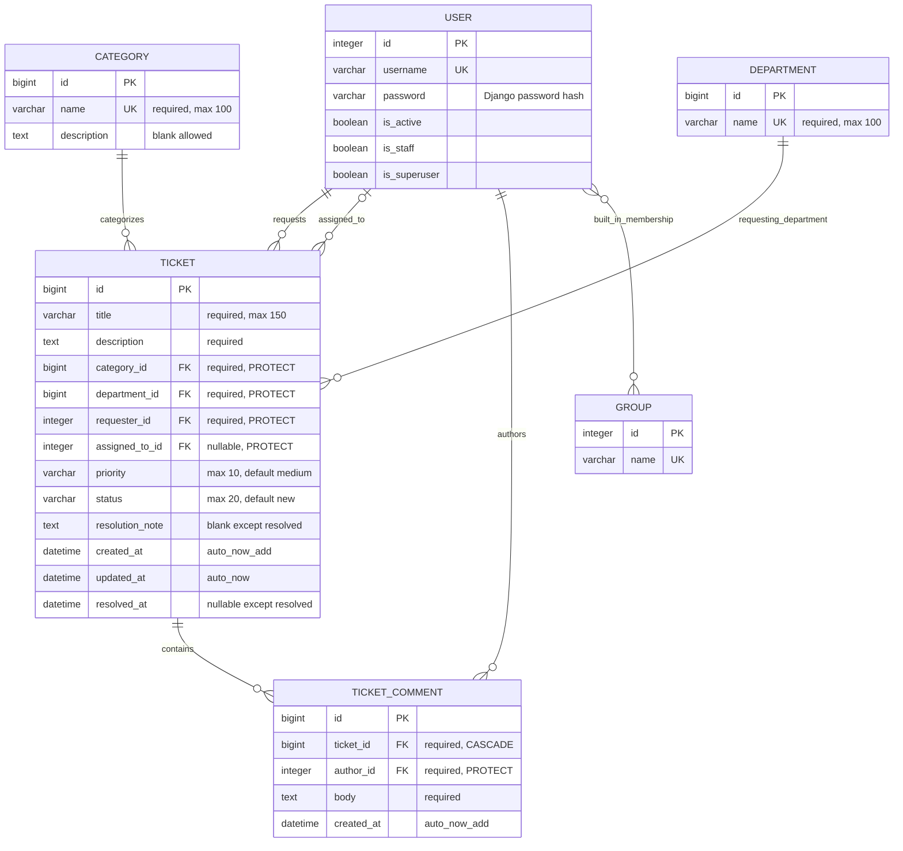

# HelpDesk Pro entity relationship diagram

**Implemented and schema-verified in Checkpoint B.** This diagram matches the four custom models and applied `tickets/0001_initial.py`. The automated schema check verifies exact fields, BigAutoField keys, nullability, FK targets/deletion choices, database columns and the four named state constraints. Recheck against the final submitted revision in G. Built-in auth entities are shown with representative fields, not their entire Django schema.

## Cardinality and optionality

| Parent | Child relationship |
| --- | --- |
| Category | Zero or more tickets; each ticket has exactly one category |
| Department | Zero or more tickets; each ticket has exactly one requesting department |
| User as requester | Zero or more tickets; each ticket has exactly one requester |
| User as assignee | Zero or more tickets; each ticket has zero or one assignee |
| Ticket | Zero or more comments; each comment has exactly one ticket |
| User as author | Zero or more comments; each comment has exactly one author |
| User/Group | Built-in many-to-many through Django's automatically managed membership table |

There is no User–Department foreign key and no custom profile or group join model. Application roles constrain eligible memberships separately from the general auth M2M cardinality.

## Integrity and rationale

Category/Department names are required and unique; FK references prevent repeated organizational names on tickets. Requester and comment author are persisted references rather than copied account data. Status and priority use choices and database allowed-value checks. Required text is trimmed and validated. Database checks cover assignment/state and resolution fields as described in [DESIGN.md](DESIGN.md).

PROTECT prevents deletion of categories, departments and users referenced by tickets/comments, including terminal history. A user referenced only as an assignee is also protected. Cancelled tickets keep their record and any assignee/comments. CASCADE describes comment cleanup if a ticket is deleted by privileged maintenance; application/admin ticket deletion is disabled. Role/eligibility changes and previous-state transitions are application rules, not cross-table database constraints.

Applied constraints: ticket_valid_status, ticket_valid_priority, ticket_assignment_matches_status and ticket_resolution_matches_status. Validation additionally trims required text, rejects null optional text for non-null columns, requires a meaningful resolution note, validates active assignee eligibility and rejects terminal/comment edits. Transitional actor authorization and lifecycle services are implemented in C; B helpers establish their permission contracts.
