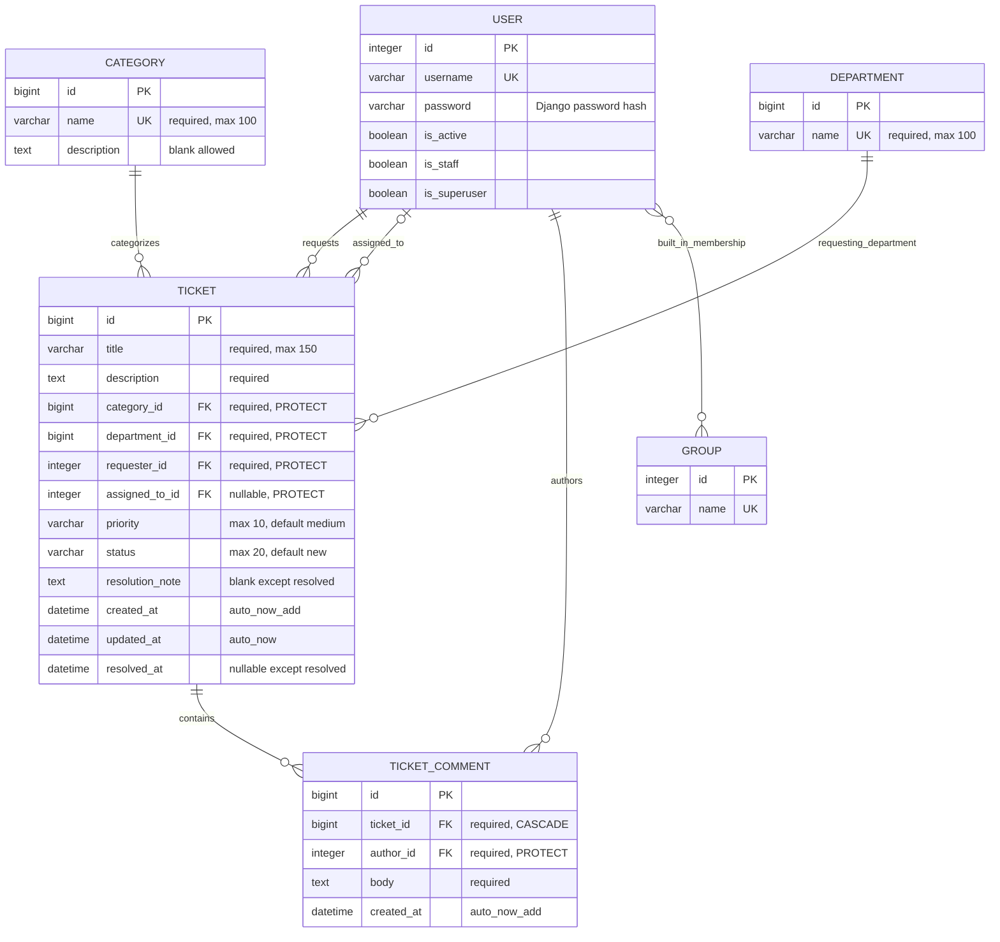

# Entity Relationship Diagram (ERD)

HelpDesk Pro uses four application models—**Department**, **Category**, **Ticket**, and **TicketComment**—alongside Django's built-in **User** and **Group** models. The diagram shows their keys, relationships, and field requirements. See the [Django models](../tickets/models.py) for the implementation.

## Relationships

| Relationship | Cardinality |
|---|---|
| Category → Ticket | One category to many tickets; category required |
| Department → Ticket | One department to many tickets; department required |
| User → Ticket (requester) | One user to many tickets; requester required |
| User → Ticket (assignee) | One user to many tickets; assignee optional |
| Ticket → TicketComment | One ticket to many comments |
| User → TicketComment | One author to many comments |
| User ↔ Group | Many-to-many through Django's built-in membership table |

## Data integrity

- Category and department names are unique.
- **PROTECT** prevents deletion of referenced categories, departments, and users.
- **CASCADE** removes related comments if a ticket is deleted at the database level; ticket deletion is disabled in normal application workflows.
- Database constraints validate ticket status, priority, assignment, and resolution consistency: `ticket_valid_status`, `ticket_valid_priority`, `ticket_assignment_matches_status`, and `ticket_resolution_matches_status`.
- Forms and application services validate required text, role permissions, and permitted ticket status transitions.
